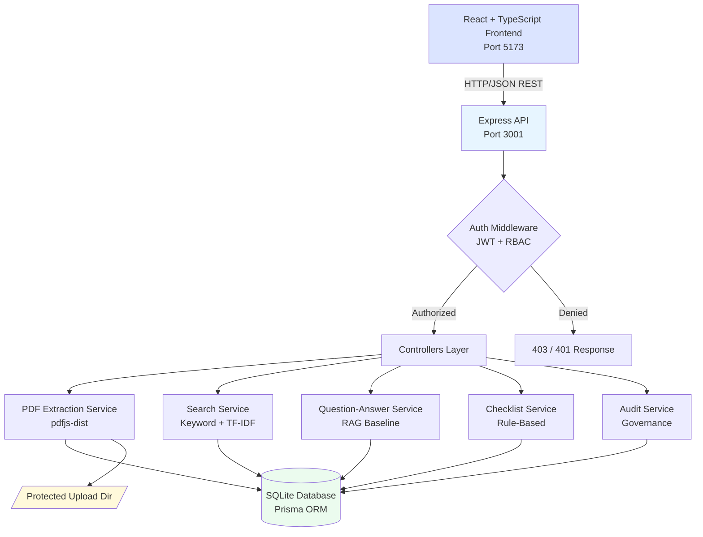

# Architecture — Secure AI-Powered Legal Document Intelligence Platform

## Overview

A local-first full-stack application demonstrating all four Wipro CPPE modules using a clean layered architecture.

## System Architecture Diagram



## Document Ingestion Pipeline (Module 2)

```
PDF Upload → File Validation (size, type, magic bytes) → Random Stored Filename (UUID)
    → SHA-256 Hash → pdfjs-dist Extraction → Page-by-Page Text
    → Whitespace Normalization → SQLite Storage (DocumentPage per page)
    → Extraction Status Update (EXTRACTED / OCR_REQUIRED / FAILED)
    → Audit Log
```

## Question-Answering Flow (Module 3 — RAG Baseline)

```
User Question → Tokenize → Search All Document Pages (TF-IDF scoring)
    → Filter by Relevance Score → Top-K Passages
    → Template Response Builder (NO invented content)
    → Attach Page Citations → Return with Disclaimer
```

## Security Flow (Module 4)

```
Request → Rate Limiter → CORS → Helmet Headers → JWT Verification
    → Role Check (RBAC) → Ownership Check (IDOR prevention)
    → Controller Logic → Audit Log
```

## Data Flow: Frontend → Backend

```
React Component → axios API client (Bearer token injected)
    → Express route → Zod validation → Authentication middleware
    → Role middleware → Controller → Service layer
    → Prisma ORM (parameterised) → SQLite
    → JSON response → React state update → UI render
```

## Technology Decisions

| Concern | Choice | Why |
|---------|--------|-----|
| Frontend | React + TypeScript + Vite | Fast build, type safety, wide ecosystem |
| Backend | Node.js + Express + TypeScript | Consistent TS across stack, broad library support |
| Database | SQLite + Prisma | Local-first, zero-server, type-safe ORM |
| PDF Extraction | pdfjs-dist | Pure Node.js, no native deps, maintained by Mozilla |
| Auth | JWT + bcrypt | Stateless, well-understood, no external service required |
| Validation | Zod | Runtime type-safety matching TypeScript types |
| API Docs | Swagger/OpenAPI | Auto-generated from JSDoc, standard format |
| Containerisation | Docker + Docker Compose | Module 1 requirement, repeatable builds |

## Key Security Boundaries (Module 4)

- Uploaded files stored outside the web root — never served directly
- Stored filenames are UUIDs — original filename never trusted
- Every data access checks ownership before returning records
- Audit log entries never contain passwords, tokens, or document text
- Secrets live in `.env` files excluded from git via `.gitignore`
